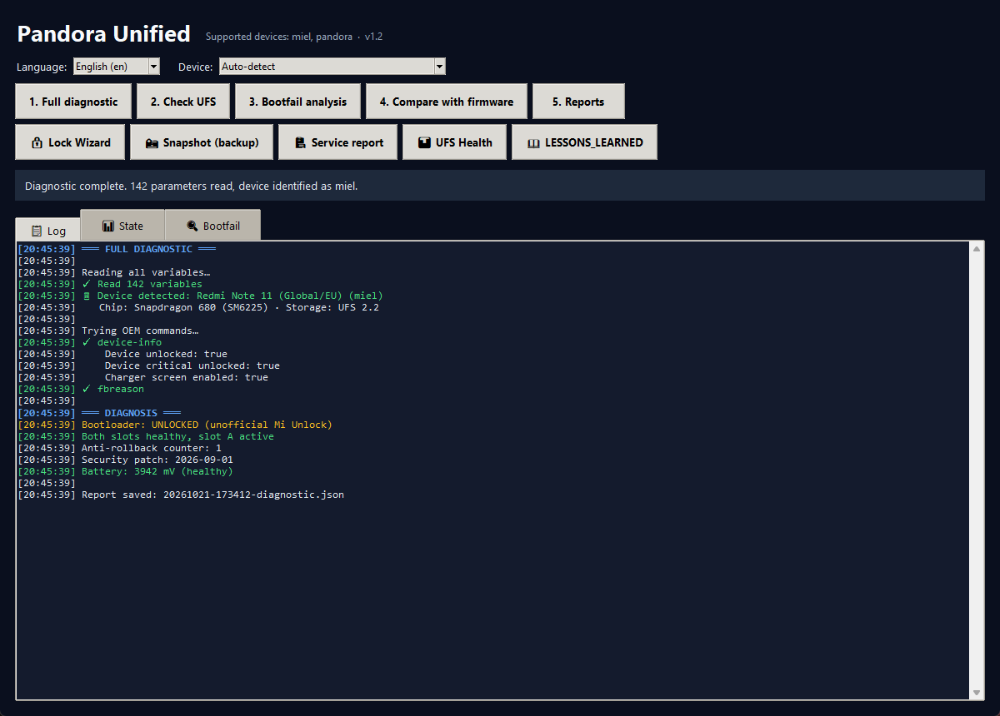
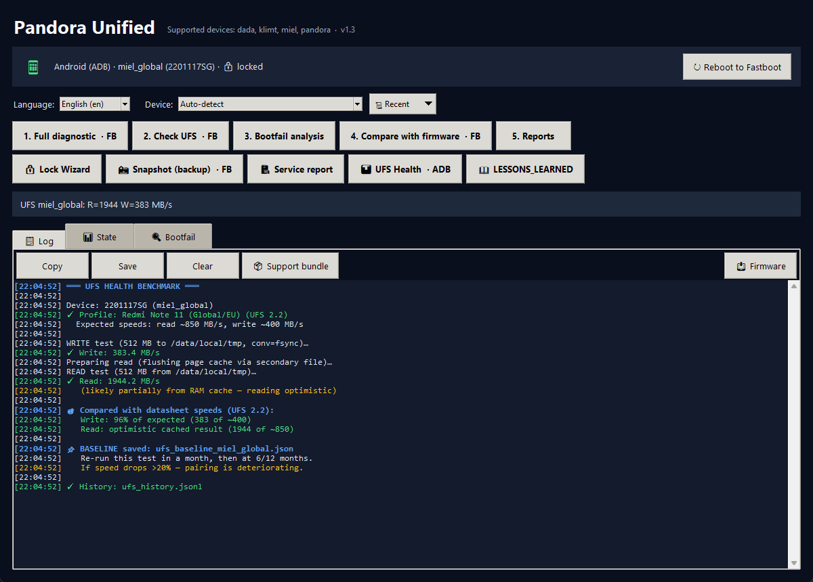
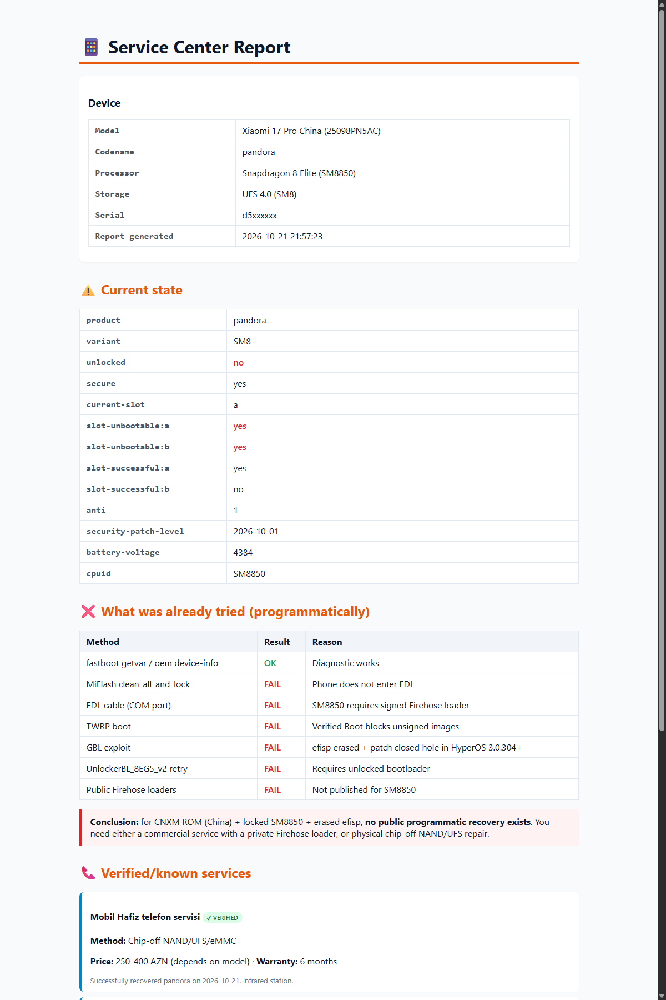

> **Review update (2026-10-21):** Lock Wizard is now a read-only reference; batch generation has been removed. The repair history has been corrected against the owner-provided correspondence; completion remains unconfirmed. See [review and remaining issues](docs/REVIEW-2026-10-21.md).

# Pandora Unified — Xiaomi Diagnostics & Recovery Toolkit

> Open-source GUI tool for Xiaomi diagnostics, diagnostic snapshots and relock reference information.
> Developed during investigation of a Xiaomi 17 Pro boot failure after relocking.

**🌍 Languages:** English · [Русский](README.ru.md)
**🔧 Platform:** Windows (uses Xiaomi's fastboot/adb binaries bundled in `adb/`)
**📝 License:** MIT — see [LICENSE](LICENSE)

## Screenshots



The main window with a Redmi Note 11 auto-detected via `fastboot getvar product`.

The Lock Wizard now displays read-only reference information. The former procedural screenshot is omitted because it no longer represents the interface.



UFS Health runs an `adb shell dd` benchmark, saves a per-device baseline on first run, and warns if speed drops >20% on later runs — a performance comparison, not a diagnosis of solder joints or remaining lifespan.



The service report generates a self-contained HTML with device state, methods already tried, known services, and a verdict block that adapts to the device profile.

---

---

## Why this exists

On 15 October 2026, a Xiaomi 17 Pro China (`pandora`) stopped booting after the assistant executed `fastboot erase efisp` and `fastboot oem lock`. Both returned `OKAY`. The subsequent log showed unbootable slots; the full cause was not established.

On 21 October the owner agreed to a repair quote of **300 AZN**, with an estimate of **up to two days**. The technician discussed possible UFS/processor removal and planned HyperOS 3 with a locked bootloader. Completion, the actual repair method, warranty terms and the installed version have not been confirmed by the owner.

The technician recommended a full official reflash with locking after erasing efisp, rather than the direct lock performed here. This is an attributed recommendation, not a procedure verified by this project. See [the corrected incident record](LESSONS_LEARNED.md).

## Features

| Feature | What it does |
|---------|--------------|
| **Full diagnostic** | Reads all `fastboot getvar` + `oem` state, saves JSON report |
| **UFS check** | Detects storage vendor (critical for auth-free firehose compatibility) |
| **Bootfail analysis** | Parses `.bin` bootfail dumps for boot errors, versions, boot reasons |
| **Compare with firmware** | Compares partition sizes with profile constants; does not verify OTA contents |
| **🔒 Lock Wizard** | Read-only relock reference; no lock or erase scripts |
| **📸 Snapshot** | One-click backup of `getvar all`, OEM dumps, dynamic token to a zip — run BEFORE any risky op |
| **🏥 Service report** | Self-contained HTML for a repair technician: device state, methods tried, services |
| **📊 UFS Health** | ADB-based `dd` read/write benchmark. First run = baseline. Later runs compare and warn if speed drops >20% (not a solder-health or lifespan assessment) |

## Supported devices

| Codename | Device | Chip | Storage | Unlock method |
|----------|--------|------|---------|---------------|
| `pandora` | Xiaomi 17 Pro China | Snapdragon 8 Elite (SM8850) | UFS 4.0 | exploit |
| `dada` | Xiaomi 15 | Snapdragon 8 Elite (SM8750-AB) | UFS 4.0 / 3.1 | exploit (CN) / Mi Unlock (Global) |
| `klimt` | Xiaomi 15T Pro | **MediaTek** Dimensity 9400+ | UFS 4.0 | Mi Unlock |
| `miel` | Redmi Note 11 | Snapdragon 680 | UFS 2.2 | Mi Unlock |

> **MediaTek vs Qualcomm**: the tool handles both. The low-level recovery path differs — for MediaTek devices like `klimt`, the EDL equivalent is **BROM mode** and MiFlash is replaced by **SP Flash Tool**. See each profile's `tried_methods` for the device-specific flow.

**Your device not listed?** Adding one is a 10-minute JSON edit — see [profiles/README.md](profiles/README.md).

## Languages

- English (`en`)
- Русский (`ru`)
- Azərbaycanca (`az`)

Switch at runtime from the Language dropdown. Choice is persisted.

## Requirements

- Windows 10/11
- Python 3.8+ (ships with Tkinter)
- No pip dependencies — standard library only
- `adb/fastboot.exe` and `adb/adb.exe` in `adb/` folder (Xiaomi platform-tools)

## Running

```bash
python pandora_unified.py
```

That's it. Everything else is in the GUI.

## Repository layout

```
pandora_unified.py          # The GUI tool
profiles/                   # Device profiles (one JSON per device)
  pandora.json
  miel.json
  _template.json            # Copy this to add your device
  README.md
translations/               # UI translations (one JSON per language)
  en.json
  ru.json
  az.json
LESSONS_LEARNED.md          # What NOT to do when locking bootloader
README.md                   # This file
README.ru.md                # Original Russian narrative (recovery timeline)
LICENSE                     # MIT
CONTRIBUTING.md             # How to add a device / language
adb/                        # fastboot.exe + adb.exe (Windows)
```

## Contributing

**Device profiles and translations are plain JSON — no code required.** See [CONTRIBUTING.md](CONTRIBUTING.md).

Target devices we'd love profiles for:
- Redmi Note 11 Pro (`spes`, `spesn`)
- POCO F series (`munch`, `psyche`)
- Xiaomi flagships with Snapdragon 7/8 series
- Anything with a known-tricky unlock/lock dance

## ⚠️ Disclaimers

This tool CANNOT:
- Perform EDL/firehose flashing (no signed loaders published)
- Unlock a locked bootloader (that's done via Mi Unlock Tool or an exploit)
- Determine or repair physical UFS/NAND damage

It CAN:
- Diagnose what state your phone is in
- Document the incident and limitations of the diagnostic evidence
- Give you a professional report to hand to a repair shop
- Compare storage benchmark measurements over time

**Everything is at your own risk.** Backing up before any risky operation is on you — the Snapshot button helps but is not a substitute for a TWRP full backup when possible.

## Credits

- Original device-recovery timeline, lessons, and tool authorship: @alizaderamil
- The repair technician consulted by the owner, who supplied a quote and a relock recommendation; repair completion is not yet confirmed
- Development collaboration with Claude Code

## Links

- Issue / discussion: GitHub issues on this repo
- Repository: https://github.com/alizaderamil/pandora-unified-toolkit
- Ready-to-paste community announcements: [docs/PROMOTION.md](docs/PROMOTION.md)
- How to add screenshots: [docs/SCREENSHOTS.md](docs/SCREENSHOTS.md)
